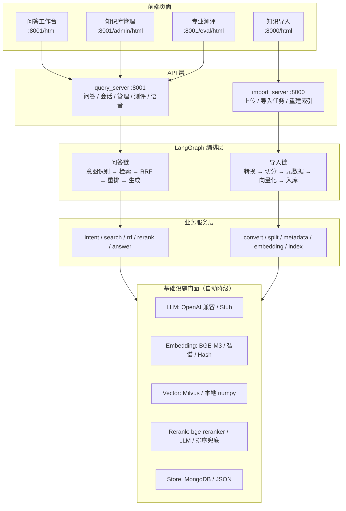
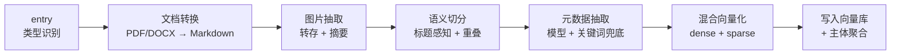
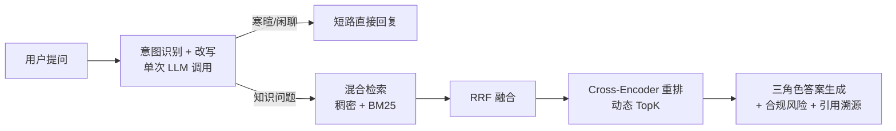

# 跨境电商 RAG 智能问答系统


> 一个面向跨境电商卖家的**生产级知识库智能问答系统**：双层 LangGraph 编排、混合检索 + RRF + Rerank、多后端自动降级、领域元数据与合规风险雷达、内置专业测评体系。开箱零外部依赖即可跑通「文档导入 → 检索 → 问答 → 测评」全流程。

---

## 📖 目录

- [为什么需要它](#-为什么需要它)
- [✨ 核心特性](#-核心特性)
- [🏗 系统架构](#-系统架构)
- [🔄 两条 LangGraph 链路](#-两条-langgraph-链路)
- [🖥 界面预览](#-界面预览)
- [🎯 全流程演示](#-全流程演示)
- [💬 示例问答](#-示例问答)
- [📊 测评结果](#-测评结果)
- [🧱 技术栈](#-技术栈)
- [🚀 快速开始](#-快速开始)
- [🔌 API 文档](#-api-文档)
- [📁 目录结构](#-目录结构)
- [🧪 测试与测评](#-测试与测评)
- [🔁 多后端降级矩阵](#-多后端降级矩阵)
- [❓ 常见问题](#-常见问题)
- [📄 许可证](#-许可证)

---

## 🎯 为什么需要它

跨境电商的规则知识散落在平台政策、卖家论坛、税务法规里，且**中英混杂、术语密集、平台差异大**：

- 新手卖家问「FBA 费用怎么算」，文档里写的是「亚马逊物流配送费」——关键词对不上；
- 同一个「退货」在亚马逊、速卖通、TikTok Shop 的规则完全不同，通用 RAG 容易串平台；
- 账号封禁、侵权、VAT 这类**高危问题**，答错代价极大，需要显式风险提示。

本系统针对这些痛点做了领域化设计：**术语归一化 + 平台/市场/类目四维元数据 + 合规风险雷达 + 三角色回答模板 + 引用溯源**。

---

## ✨ 核心特性

| 维度 | 能力 |
|---|---|
| **工程架构** | 六层分层（`api / infra / rag / process / shared / source`）+ 基础设施门面封装，可替换、可测试 |
| **链路编排** | 双层 LangGraph：导入链与问答链完全解耦，节点级进度可视化 |
| **检索质量** | 稠密 + BM25 混合检索 → RRF 融合 → Cross-Encoder 重排 → 按分差动态 TopK |
| **多后端降级** | Milvus ⇄ 本地 numpy 向量库；BGE-M3 ⇄ 智谱 API ⇄ 哈希向量；bge-reranker ⇄ LLM 兜底；Mongo ⇄ JSON |
| **领域适配** | 四维元数据（平台×市场×类目×文档类型）、中英术语词典、合规风险雷达、三角色模板 |
| **性能** | C 语言加速文本分块与余弦相似度（**加载自检，脏库自动降级纯 Python**） |
| **可观测** | 结构化日志、SSE 节点级进度、引用溯源、任务状态轮询 |
| **质量保障** | 检索 5 指标 + 生成 5 维度（含合规安全一票否决）+ 20 条金标准测试集 + 95 条自动化测试 |
| **多租户与权限** | 可选 API Key 鉴权中间件 + 按租户隔离向量库/历史/版本（关闭时与单租户零差异） |
| **增量更新** | 文件指纹（SHA-256）驱动：内容未变化自动跳过重索引 + 文档版本历史可追溯 |
| **平台规则模板** | 内置 Amazon / Temu / Shopee / Lazada 等平台规则重点、合规关注与推荐文档类型 |
| **第三方评测** | 可选对接 RAGAS / TruLens 标准指标，复用项目自身 LLM 配置，未安装则优雅降级 |
| **部署形态** | 支持源码运行与 Docker / docker-compose 一键部署（单容器双服务） |

---

## 🏗 系统架构



---

## 🔄 两条 LangGraph 链路

**导入链（异步任务，节点级进度回传）**



**问答链（同步 / SSE 流式）**



---

## 🖥 界面预览

| 页面 | 地址 | 说明 |
|---|---|---|
| 💬 **问答工作台** | `http://localhost:8001/html` | 对话主区 + 右侧「检索依据 / 合规提示 / 历史会话」；角色切换、流式输出、引用溯源 |
| 📚 **知识库管理** | `http://localhost:8001/admin/html` | 按平台/市场/类目聚合的知识主体列表、切片明细、删除主体 |
| 📊 **专业测评** | `http://localhost:8001/eval/html` | 测试集浏览、一键运行测评、指标与等级展示 |
| 📥 **知识导入** | `http://localhost:8000/html` | 拖拽上传、导入进度、任务状态轮询 |

> 三个服务端页面均内置现代化深色 UI（原生 HTML/CSS/JS，无需构建）。启动 `python run.py` 后直接访问即可。

---

## 🎯 全流程演示

### 1) 导入知识文档（8000）

```bash
curl -X POST "http://localhost:8000/upload" \
  -F "files=@app/source/doc/亚马逊FBA入仓与仓储规则.md"
```

```json
{
  "code": 200,
  "message": "已提交 1 个导入任务",
  "task_ids": ["3f2a9c1e-..."],
  "duration_ms": 12
}
```

### 2) 查询导入进度（8000）

```bash
curl "http://localhost:8000/status/3f2a9c1e-..."
```

```json
{
  "code": 200,
  "task_id": "3f2a9c1e-...",
  "status": "completed",
  "done_list": ["文档转换", "图片抽取", "语义切分", "元数据抽取", "混合向量化", "写入向量库"],
  "running_list": []
}
```

### 3) 提问（8001，非流式）

```bash
curl -X POST "http://localhost:8001/query" \
  -H "Content-Type: application/json" \
  -d '{"query":"亚马逊FBA仓储费怎么计算？滞销库存太多怎么办？","role":"seller"}'
```

```json
{
  "message": "ok",
  "session_id": "a1b2c3d4-...",
  "answer": "结论：FBA 仓储费按月计费，费用 = 平均库存体积(立方英尺) × 月仓储费率...",
  "done_list": ["意图识别", "混合检索", "RRF融合", "重排", "答案生成"],
  "image_urls": []
}
```

### 4) 流式问答（SSE）

```bash
# 第一步：开启流式，拿到 session_id
curl -X POST "http://localhost:8001/query" \
  -H "Content-Type: application/json" \
  -d '{"query":"欧洲VAT税率是多少，怎么申报？","role":"operator","is_stream":true}'

# 第二步：订阅事件流
curl -N "http://localhost:8001/stream/a1b2c3d4-..."
```

事件序列：`meta → node（节点进度）→ delta（逐字输出）→ done`

### 5) 兼容旧版契约（V1）

```bash
curl -X POST "http://localhost:8001/qa" \
  -H "Content-Type: application/json" \
  -d '{"question":"亚马逊退货规则是什么？"}'
```

```json
{"code": 200, "question": "亚马逊退货规则是什么？", "answer": "..."}
```

### 6) 运行专业测评

```bash
curl -X POST "http://localhost:8001/api/eval/run?mode=offline&use_llm=false"
curl "http://localhost:8001/api/eval/status?task_id=eval_xxx"
```

---

## 💬 示例问答

| 角色 | 问题 | 回答要点（节选） |
|---|---|---|
| 新手卖家 | FBA 仓储费怎么算？滞销库存怎么办？ | **结论**：按月按体积计费，旺季费率上调；**步骤**：①查库存龄 ②清货（站外 Deal/移除）③设置库存上限；**风险提示**：长期仓储附加费在 365 天显著上升 |
| 成熟运营 | ACoS 太高怎么优化？ | **策略**：拆分自动/手动广告，否定无效词，优化 Listing 转化率；**指标**：ACoS 目标 = 毛利率 × 广告占比；**引用**：《亚马逊广告投放与ACoS优化》 |
| 风控专家 | 跟卖被投诉侵权会封号吗？ | **结论**：可能触发账号审核甚至封禁；**合规动作**：①立即下架 ②准备授权/发票 ③提交 POA；**风险等级**：高（账号封禁 / 知识产权） |

> 高危问题会自动命中**合规风险雷达**（账号封禁/关联、知识产权、VAT 税务、禁售品、平台处罚），并在答案中注入【风险提示】栏目与可执行合规动作清单。

---

## 📊 测评结果

内置 20 条跨境电商金标准测试集（覆盖 seller / operator / expert 三角色，含合规安全性用例）：

| 类别 | 指标 | 说明 |
|---|---|---|
| 检索 | HitRate@5 / Recall@5 / Precision@5 / MRR / NDCG@5 | 是否召回金标准文档 |
| 生成 | 忠实度 / 答案相关性 / 上下文相关性 / 完整性 | LLM-as-Judge + 启发式兜底 |
| 安全 | **合规安全性**（一票否决） | 是否给出违规/高风险建议 |
| 综合 | 加权总分 + A~F 等级 | 支持纯 LLM 基线对比 |

> **第三方评测（可选）**：安装 `pip install -e ".[eval]"`（RAGAS / TruLens / datasets）后，
> 在测评接口加 `third_party=true`（或 `python -m evaluation.run_eval --third-party`）即可额外输出
> faithfulness / answer_relevancy / context_precision / context_recall 等学界标准指标；未安装时自动降级到自研测评。

```bash
# 零依赖自检（无需 LLM，验证指标引擎与链路）
python -m evaluation.run_eval --mode selftest --no-save

# 离线真实评估（需配置 LLM）
python -m evaluation.run_eval --mode offline --use-llm

# 叠加 RAGAS / TruLens 第三方指标（需选装依赖）
python -m evaluation.run_eval --mode offline --use-llm --third-party
```

---

## 🧱 技术栈

| 模块 | 技术 | 版本要求 |
|---|---|---|
| Web 框架 | FastAPI + Uvicorn | ≥ 0.110 |
| 链路编排 | LangGraph（缺失时自动降级为顺序执行） | 1.x |
| 向量检索 | 本地 numpy（默认）/ Milvus（生产） | — |
| 文本向量 | BGE-M3 / 智谱 embedding / 哈希（兜底） | 可选 |
| 重排 | bge-reranker / LLM 兜底 / 排序兜底 | 可选 |
| 文档解析 | pypdf / python-docx / MinerU（可选） | — |
| 历史存储 | 本地 JSON（默认）/ MongoDB | 可选 |
| 性能加速 | C（gcc + ctypes），带加载自检 | 可选 |
| 测评 | 自研 metrics + LLM-as-Judge（可选 RAGAS / TruLens） | `pip install -e ".[eval]"` |
| 多租户 | ContextVar 请求级租户 + 命名空间隔离 | 可选（AUTH_ENABLED） |
| 鉴权 | Starlette 中间件 API Key（Bearer / X-API-Key） | 可选 |
| 部署 | Docker / docker-compose（单容器双服务） | — |
| 测试 | pytest（stub 提供方，零外部依赖） | — |

---

## 🚀 快速开始

### 1. 环境准备

```bash
# 建议 Python 3.10+
python -m venv .venv
# Windows
.venv\Scripts\activate
# macOS / Linux
source .venv/bin/activate

pip install -r requirements.txt
```

> 最小依赖即可运行；Milvus / MongoDB / MinIO / BGE 模型均为可选，缺失会自动降级。

### 2. 配置密钥（可选）

```bash
cp .env.example .env
```

编辑 `.env`，填入任意 **OpenAI 兼容**接口：

```env
OPENAI_API_KEY=你的API密钥
OPENAI_BASE_URL=https://dashscope.aliyuncs.com/compatible-mode/v1
OPENAI_MODEL=qwen-plus
```

> 不配置密钥也能启动：系统会进入「检索预览模式」，返回检索到的原文片段，用于快速验证导入与检索链路。

### 3. 编译 C 加速库（可选）

```bash
# Windows
cd csrc && build.bat
# Linux / macOS
cd csrc && bash build.sh
```

> 不编译也完全可用（纯 Python 实现）；编译后首次加载会**强制自检**，异常 DLL 会被自动禁用并降级。

### 4. 启动服务

```bash
python run.py
```

或分服务启动：

```bash
python -m uvicorn app.api.http.import_server:app --port 8000
python -m uvicorn app.api.http.query_server:app --port 8001
```

启动后访问：

| 入口 | 地址 |
|---|---|
| 问答工作台 | http://localhost:8001/ |
| 知识库管理 | http://localhost:8001/admin/html |
| 专业测评 | http://localhost:8001/eval/html |
| 知识导入 | http://localhost:8000/html |
| Swagger | http://localhost:8001/docs |

### 5. 首次体验

1. 打开 `http://localhost:8000/html`，上传 `app/source/doc/` 下的示例文档；
2. 打开 `http://localhost:8001/`，选择角色后提问，例如「FBA 仓储费怎么算」；
3. 打开 `http://localhost:8001/eval/html`，一键运行测评查看指标。

---

## 🐳 Docker 部署

不装任何依赖、一条命令拉起整套服务（导入 8000 + 问答 8001）。

```bash
# 构建并后台启动（首次构建会自动用 gcc 编译 C 加速库）
docker compose up -d --build

# 查看日志
docker compose logs -f

# 停止
docker compose down
```

- 镜像基于 `python:3.11-slim`，安装 `gcc` 编译 C 加速带（编译失败自动降级纯 Python，不影响启动）；
- `docker-compose.yml` 已挂载 `./data ./output ./logs` 卷，知识库与向量库持久化，容器销毁不丢数据；
- 默认绑定 `0.0.0.0:8000/8001`；如需鉴权/多租户，在 `.env` 配置 `AUTH_ENABLED` / `API_KEYS` 后挂载进容器即可。

---

## 🔐 多租户与鉴权

默认关闭、零侵入：关闭时与单机单租户行为完全一致，所有路径不变。

```env
# .env 开启 API Key 鉴权与多租户隔离
AUTH_ENABLED=true
# key:租户 绑定；纯 key 绑定默认租户 default
API_KEYS=sk_prod:tenantA,sk_test:tenantB,sk_default
```

- 公开路径（`/health`、`/html` 页面、`/docs`）永远免鉴权，保证 UI 可打开；
- 其余接口需携带 `Authorization: Bearer <key>` 或 `X-API-Key: <key>`，缺失返回 `401`；
- 合法 Key 自动把对应租户写入请求上下文，**向量库 / 历史记录 / 版本记录按租户命名空间隔离**（默认租户沿用原路径，不破坏既有数据）；
- 关闭 `AUTH_ENABLED` 时无任何额外开销与行为变化。

---

## 🔁 增量更新与文档版本管理

导入服务按**文件指纹（SHA-256）**判断是否变化：

- 同一主体内容未变化再次上传 → 自动跳过向量化与入库，标记「内容未变化-跳过重索引」，秒级完成；
- 内容有变化 → 仅对变更文档重新索引，旧切片由入库链路幂等覆盖；
- 每次成功导入都会落一条版本记录（指纹 / 分片数 / 时间戳），可随时查询：

```bash
curl "http://localhost:8000/api/import/versions/亚马逊FBA入仓与仓储规则"
```

```json
{
  "code": 200, "item_name": "亚马逊FBA入仓与仓储规则", "count": 3,
  "versions": [
    {"hash":"9f1c...", "chunk_count":12, "updated_at":"2026-10-19 16:00:00"},
    {"hash":"3a7b...", "chunk_count":11, "updated_at":"2026-10-18 09:30:12"}
  ]
}
```

---

## 🔌 API 文档

### 导入服务（8000）

| 接口 | 方法 | 说明 |
|---|---|---|
| `/health` | GET | 健康检查 |
| `/upload` | POST | 多文件上传（multipart `files`，内容未变自动跳过） |
| `/status/{task_id}` | GET | 导入任务进度 |
| `/reindex/{item_name}` | POST | 重建指定主体索引 |
| `/api/import/versions/{item_name}` | GET | 文档版本历史（指纹/分片数/时间） |
| `/html` | GET | 导入页面 |

### 查询服务（8001）

| 接口 | 方法 | 说明 |
|---|---|---|
| `/health` | GET | 健康检查（含向量库后端信息） |
| `/query` | POST | 问答（`is_stream=true` 走 SSE） |
| `/qa` | POST | 简化问答（V1 兼容契约） |
| `/stream/{session_id}` | GET | SSE 结果流 |
| `/history/{session_id}` | GET | 会话历史 |
| `/sessions` | GET/POST | 会话列表 / 新建 |
| `/admin/items` | GET | 知识主体列表 |
| `/admin/items/{item}/chunks` | GET | 切片明细 |
| `/admin/items/{item}` | DELETE | 删除主体 |
| `/api/platform-templates` | GET | 各平台规则模板（Temu/Shopee/Lazada…） |
| `/api/eval/testset` | GET | 测试集 |
| `/api/eval/run` | POST | 启动测评（`third_party=true` 启用 RAGAS/TruLens） |
| `/api/eval/status` | GET | 测评进度 |
| `/voice/transcribe` · `/tts` | POST | 语音转写 / 合成（可选） |

---

## 📁 目录结构

```plaintext
ec_rag/
├── app/
│   ├── api/                 # HTTP 入口与 Pydantic 模型
│   │   ├── http/            #   import_server(8000) / query_server(8001)
│   │   └── schemas/
│   ├── infra/               # 基础设施门面（可替换、可降级）
│   │   ├── llm/ vectorstore/ document_parse/ object_storage/ persistence/ config/
│   ├── process/             # LangGraph 编排 + 前端页面
│   │   ├── import_/agent/   #   导入链节点
│   │   ├── query/agent/     #   问答链节点
│   │   ├── import_/page/    #   import.html
│   │   ├── query/page/      #   chat.html / admin.html
│   │   └── eval/page/       #   eval.html
│   ├── rag/                 # 业务服务层
│   │   ├── import_/ query/ admin/ session/ voice/
│   ├── shared/              # 公共层
│   │   ├── config/ model/ runtime/ utils/ clients/
│   └── source/
│       ├── prompts/         # 提示词模板（意图/元数据/三角色答案/HyDE…）
│       └── doc/             # 14 篇跨境电商示例知识库
├── csrc/                    # C 加速源码（分块 / 相似度）+ 编译脚本
├── data/                    # raw 上传目录 + vector_store 本地向量库 + 版本记录
├── evaluation/              # 测评模块（metrics / judge / runner / third_party / testset）
├── tests/                   # pytest 测试套件（含新增功能测试）
├── docs/                    # 技术文档
├── scripts/                 # 演示脚本
├── run.py                   # 一键启动
├── Dockerfile               # 生产镜像（单容器双服务）
├── docker-compose.yml       # 一键编排（含数据卷与健康检查）
├── .dockerignore
├── requirements.txt
├── .env.example
└── LICENSE
```

> 新增业务模块：`app/api/http/auth.py`（鉴权中间件）、`app/shared/runtime/tenant.py`（租户上下文）、
> `app/rag/import_/version_service.py`（版本管理）、`app/rag/import_/platform_templates.py`（平台规则模板）、
> `evaluation/third_party.py`（RAGAS / TruLens 对接）。

---

## 🧪 测试与测评

```bash
# 单元 / 集成测试（stub 提供方，无需任何外部服务）
pytest tests/ -v

# 指标引擎自检（零依赖）
python -m evaluation.run_eval --mode selftest --no-save

# 离线真实评估（需 LLM）
python -m evaluation.run_eval --mode offline --use-llm

# 离线评估并额外调用 RAGAS / TruLens（需 pip install -e ".[eval]"）
python -m evaluation.run_eval --mode offline --use-llm --third-party

# 端到端演示脚本（导入 14 篇文档 → 问答 → 测评）
python scripts/demo_e2e.py
```

当前状态：**95 passed / 1 skipped**（跳过项为 C 库未编译用例）。

---

## 🔁 多后端降级矩阵

系统在**任何依赖缺失时都能运行**，这是刻意的工程约束：

| 能力 | 首选 | 备选 | 兜底 |
|---|---|---|---|
| 文本向量 | BGE-M3（本地） | 智谱 Embedding API | 哈希向量 |
| 向量库 | Milvus（混合检索） | — | 本地 numpy + BM25 |
| 重排 | bge-reranker | LLM 打分 | 按召回分排序 |
| 历史存储 | MongoDB | — | 本地 JSON |
| 文档解析 | MinerU | — | pypdf / python-docx |
| 图编排 | LangGraph | — | 顺序执行 |
| 文本分块 | C 库 | — | 纯 Python |
| 日志 | loguru | — | 标准库 logging |

---

## ❓ 常见问题

<details>
<summary><b>C 库加载失败 / 进程崩溃？</b></summary>

系统对 C 库做了**加载自检**：加载后立即执行一次已知输入的验证，结果不符或异常即禁用并降级纯 Python。因此异常 DLL 不会导致主进程崩溃。若需启用加速，请用 `csrc/build.bat`（Windows）或 `csrc/build.sh` 重新编译。
</details>

<details>
<summary><b>没有 LLM 密钥能跑吗？</b></summary>

可以。系统会进入「检索预览模式」：跳过生成、返回检索到的原文片段与出处。导入、检索、管理、测评（offline 客观指标）均可用。
</details>

<details>
<summary><b>检索结果为空或不相关？</b></summary>

- 确认文档已成功导入（管理页可查看切片）；
- 平台/市场/类目默认**不做硬过滤**，仅做语义增强；如确实需要可设 `RETRIEVAL_USE_SCALAR_FILTER=true`；
- 扫描件 PDF 无法抽取文本，请先 OCR。
</details>

<details>
<summary><b>端口被占用？</b></summary>

默认 8000/8001。若被其他服务占用，可改 `run.py` 或启动命令中的端口；两个服务相互独立，可分别启动。
</details>

<details>
<summary><b>如何接入自己的知识库？</b></summary>

把 Markdown / PDF / DOCX 放到 `data/raw/`，或在导入页上传。系统会自动完成转换、切分、元数据抽取与向量化。
</details>

---

## 📄 许可证

本项目基于 [MIT License](LICENSE) 开源，可自由使用、修改与商用，保留版权声明即可。

---

<p align="center">
  <sub>如果这个项目对你有帮助，欢迎 Star ⭐</sub>
</p>
